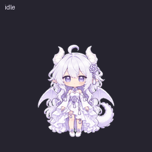

# 白龙娘 · ChatGPT Pets

按参考图制作的银白卷发、紫瞳、龙角、淡紫翅膀与卷尾 Q 版宠物。

## 在另一个账号使用

1. 下载本仓库的 `spritesheet.png` 原文件（不要保存网页缩略图）。
2. 在支持 Pets 的 ChatGPT Work 账号中启用 Pets 插件，上传该 PNG。
3. 发送：

> 请把我上传的现有 v2 宠物精灵图导入为自定义 Pets，名称“白龙娘”，描述“银白卷发、紫瞳、白色龙角与淡紫翅膀的软萌白龙娘。”。保留原图，不重新生成。先校验现有精灵图，通过后创建并启用。

此操作需要目标账号支持自定义 Pets。GitHub 用于保存素材，不会自动同步账号的宠物记录。

## 素材规格

- 透明 PNG，1536 × 2288，v2，8 列 × 11 行。
- 每帧 192 × 208；9 种动作与 16 个视线方向，共 73 帧。
- 帧数：6,8,8,4,5,8,6,6,6,8,8。
- 已通过本地结构、动作质量及 Pets 服务端校验。
- SHA-256：`4e80e435ad04eb2011a78832a65d92b0f33fe66e981f573b4702025093261cdf`

放大后会因每帧分辨率限制而模糊，建议以接近原始大小显示。

## 参考

- https://github.com/jingh12312-rgb/bailong-desktop-pet
- https://www.bilibili.com/video/BV1vwJ16MEQ5/

角色外观依据用户提供截图制作；本仓库未声明拥有原角色版权，也未额外授予原角色许可。
